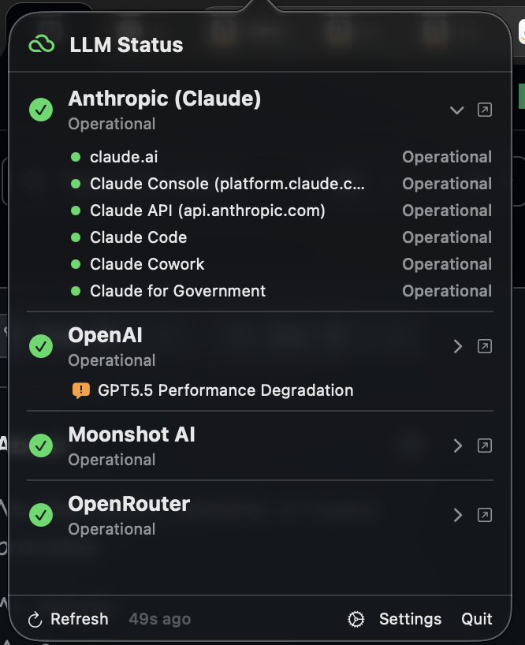

# LLM Status

A lightweight macOS menu bar app that monitors the operational status of major LLM providers in real time. One glance at the menu bar tells you whether the model you depend on is healthy — or whether the bug you're chasing is on their side.



## Supported providers

Anthropic (Claude), OpenAI, Cursor, Google (Gemini), Mistral AI, DeepSeek, Moonshot AI, OpenRouter, Perplexity, xAI (Grok), Groq.

## Features

- **Menu bar indicator** — cloud icon tinted by aggregated severity (green / yellow / orange / red).
- **Component drill-down** — expand any provider to see per-component status (e.g. Claude API vs Claude Code, OpenAI Chat Completions vs Sora).
- **Active incident surfacing** — incidents in `investigating` / `identified` / `monitoring` phases are shown inline, even when the provider's global indicator is still green.
- **Watched component** — pin a single component per provider so the menu bar reflects only what you care about.
- **Notifications** — opt-in alerts for incident start and recovery, scoped to one provider or all.
- **Disable / reorder** providers via Settings.
- **Subscription usage** — weekly and 5-hour limits of your Claude and ChatGPT (Codex) plans, read from the local Claude Code and Codex logins, with an estimated split by app and project.

## Subscription usage on servers (optional)

Codex usage spent on other machines (a VPS running agents or services that call `codex exec`) can join the Codex split. Add each machine under **Settings → Codex on SSH hosts** by its SSH alias; each host can be switched off, tested, and given extra folders to search. Nothing is configured by default and no connection is made without a host.

For each host, LLM Status runs a read-only Python 3 script over `ssh -o BatchMode=yes` (key-based login required; `sudo -n` is used when passwordless sudo is allowed, to read service folders). Only token totals with app and project names come back: no prompt, output or credential leaves the host. Usage is counted only for the ChatGPT account logged into your local Codex. The script looks under `/home`, `/root`, `/srv`, `/opt`, Docker volumes and your extra folders, and recognizes data by content:

- **Codex homes** (`~/.codex` or any `CODEX_HOME`): a folder with an `auth.json` holding ChatGPT tokens; its `sessions/` are read.
- **Hermes agents**: `state.db` next to an `auth.json` with a `credential_pool`; only `openai-codex` usage is counted.
- **`codex-usage.jsonl`**: services running `codex exec --ephemeral` leave no session file. To be counted, they append one JSON line per call to a file with this name (anywhere searched, e.g. in a Docker volume), typically from the `usage` of the `turn.completed` event printed by `codex exec --json`:

  ```json
  {"ts": "2026-10-27T09:00:05Z", "input_tokens": 48176, "cached_input_tokens": 0, "output_tokens": 1549, "project": "daily-edition"}
  ```

  `ts` (ISO 8601 or epoch seconds) and the token counts are required. Recommended: `account_id` (the ChatGPT account id, `tokens.account_id` in the service's `CODEX_HOME/auth.json`) and `id` (unique per call, so copies of the file are counted once). Optional: `app` (defaults to the folder or Docker Compose project name) and `project`. Lines without `account_id` count only when every login found on the host (Codex homes and Hermes credentials) is your account and no folder was unreadable.

Copies of the same data (backups, restore checks) are counted once: the most complete copy of a Codex session or Hermes row, and usage lines by `id` (or identical content across files).

## Requirements

- macOS 14 (Sonoma) or later
- Swift 5.9+ (only for building from source)

## Install

Grab the latest `LLMStatus.app` from the [Releases](https://github.com/jean-philippe-lefebvre/llmStatus/releases) page, or build it yourself:

```bash
make run        # build + sign + install to /Applications + launch
make install    # build + sign + install to /Applications
make all        # build the .app bundle into .build/app/
```

## How status is fetched

| Source | Providers |
|---|---|
| Atlassian Statuspage API | Anthropic, OpenAI, Cursor, DeepSeek, Moonshot |
| incident.io API | Groq |
| Google Cloud incidents JSON | Gemini |
| Datadog JSON | OpenRouter |
| HTML scraping | Mistral, Perplexity |
| Headless WebKit (Cloudflare bypass) | xAI |

All HTTP calls go through a shared `URLSession` with short timeouts; xAI uses a hidden `WKWebView` and caches the result for 10 minutes.

## Development

See [`CLAUDE.md`](CLAUDE.md) for architecture notes, key patterns, and the build/packaging pipeline.

```bash
swift build      # debug build
swift test       # tests
make clean       # wipe build/ and SPM cache
```

## License

MIT
